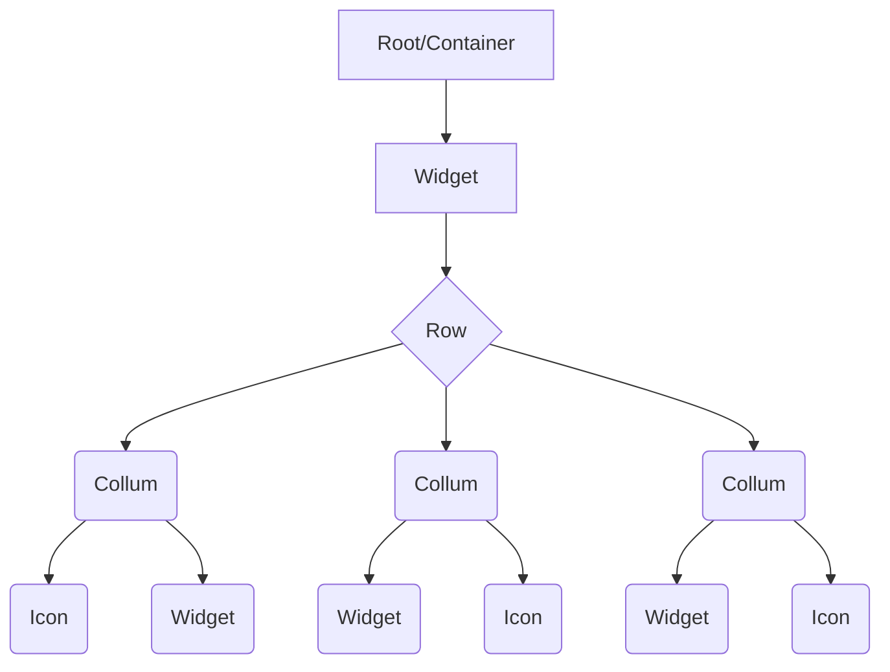

# myportofolio_mobile

A new Flutter project.

## Getting Started

This project is a starting point for a Flutter application.

A few resources to get you started if this is your first Flutter project:

- [Learn Flutter](https://docs.flutter.dev/get-started/learn-flutter)
- [Write your first Flutter app](https://docs.flutter.dev/get-started/codelab)
- [Flutter learning resources](https://docs.flutter.dev/reference/learning-resources)

For help getting started with Flutter development, view the
[online documentation](https://docs.flutter.dev/), which offers tutorials,
samples, guidance on mobile development, and a full API reference.

## Tugas

### Tugas 7

1. _widget tree_ adalah gambaran widget terstruktur yang digunakan pada sebuah proyek flutter untuk rendering frame ke layar dan testing. Dibuat saat layout dan perubahan state sebuah node widget akan dilakukan pembuatan ulang widget tersebut beserta anak-anak node yang ada dibawahnya.

  Sebuah widget induk/_parent_ membukus widget lain didalamnya dengan aturan _Constraints go down. Sizes go up. Parent sets position_
  - Sebuah widget mendapatkan batasan ukuran dari parentnya (tinggi dan lebar maksimal)
  - Lalu mencari anak-anak yang dimilikinya, memberitahu batas ukurannya dan bertanya ukuran yang diinginkan tiap anak (berbeda-beda)
  - Kemudian widget satu persatu memposisikan tiap anak secara horizontal dan vertikal
  - Terakhir widget memberitahukan ukuran dirinya sendiri ke parentnya sendiri.

2. - **MyApp**; Root teratas pada tree yang memanggil MaterialApp
   - **MaterialApp**; Template utama, mengatur judul, tema warna dan halaman utama
   - **Scaffold**; struktur visual dasar halaman (AppBar, Body, SnackBar)
   - **Appbar**; menampilkan bar nama aplikasi bagian atas halaman
   - **Padding**; padding disekelilingnya
   - **Text**; teks untuk ditampilakan dilayar (Nama, NPM, dll)
   - **Icon**; simbol bawaan pada flutter
   - **Collum**; layout widget untuk menyusun daftar widget anak (_children_) secara vertikal
   - **Row**; layout widget untuk menyusun daftar widget anak (_children_) secara horizontal
   - **Center**; pesan sambutan dan kisi tombol menu portofolio
   - **GridView**; menampilkan kartu tombol dalam tata letak kisi 3 kolom pakai `crossAxisCount: 3`
   - **Card**; memberi efek banyangan pada infoCard
   - **Container**; seperti `<div>` di html, membungkus satu widget dengan proporsi layar yang diinginkan
   - **Material**; memberi warna latar dan kelengkungan sudut (borderRadius) pada ItemCard
   - **InkWell**; tombol aksi ketika ditekan muncul SnackBar
   - **SnackBar**; menampilkan pesan dibawah ketiak InkWell pada ItemCard dipencet
   - **MyHomePage**; halaman utama aplikasi, merakit semuanya setelah dipanggil root
   - **InfoCard**; Kartu infomarsi
   - **ItemCard**; Kartu interaktif

3. `MaterialApp` itu seperti template, berfugnsi untuk mengatur global navigasi, tema dengan prinsip Material Design yang siap pakai, menyediakan kumpulan petunjuk visual dan interaktif. Ini sering digunakan sebagai root widget karena memiliki fondasi yang solid untuk mendevelop aplikasi dengan fungsi yang konsisten dan pengalaman pengguna yang telah diasah.

4. `StatelessWidget` dan `StatefulWidget` keduanya bersifat _immutable_ tetapi pada `StatefulWidget` menyimpan sebuah state yang dapat berubah secara dinamis saat adanya event tertentu seperti papan tulis yang dapat digunakan ulang. Sedangkan `StatelessWidget` memiliki state yang statis, jadi ketika dirender maka semuanya akan tetap dan hanya akan berubah ketika diganti dan render ulang, berbeda dengan `StatefulWidget` yang statenya dapat diupdate (bukan diganti semua). 
    - Pakai `StatelessWidget` jika ingin membuat UI yang statis dan tetap saja, seperti gambar, profil, judul dan sebagainya.
    - Pakai `StatefulWidget` UI yang dinamis dan dapat berubah/diubah, seperti counter, form dan sebagainya.

5. `BuildContext` itu sendiri adalah sebuah objek yang menjadi penanda (_pointer_) posisi widget didalam treenya, memberi tahu flutter dimana sebenarnya posisi widget itu berada. `BuildContext` memungkinkan untuk mengakses widget parent, berpindah antar layar/page, menampilkan dialog atau _SnackBar_, dan menentukan ruang letak. Penggunaannya setiap kali metode `build` dipanggil, ia akan menyimpan _context_/posisi dimana ia dipanggil dan meneruskannya ke child-childnya. Contoh:
```dart
class MyHomePage extends StatelessWidget {
    MyHomePage({super.key});

    final String npm = "2506543363";
    final String nama = "Vebian Francois Ariftya Manurung";
    final String kelas = "PBP D";

    final List<ItemHomepage> items = [
        ItemHomepage("Lihat Proyek", Icons.folder, Colors.indigo),
        ItemHomepage("Tambah Proyek", Icons.add_circle,Colors.indigoAccent),
        ItemHomepage("Logout", Icons.logout, Colors.lightBlue),
    ];

    @override
    Widget build(BuildContext context) { // ===> menyimpan alamat MyHomePage
        // Scaffold menyediakan struktur visual dasar halaman (AppBar, Body, SnackBar).
        return Scaffold(
        // AppBar menampilkan bar bagian atas halaman aplikasi.
        appBar: AppBar(
            title: const Text(
            'MyPortfolio',
            style: TextStyle(
                color: Colors.white,
                fontWeight: FontWeight.bold,
            ),
            ),
            backgroundColor: Theme.of(context).colorScheme.primary, //===> memakai context yang diturunkan dari MyHomePage, menelusuri parent-parentnya MyHomePage (bukan AppBar) untuk mencari Themenya (ada di parent MaterialApp)
        ),
        ...
```
  Ada juga `ScaffoldMessenger.of(context)` untuk mencari parent Scaffold yang akan menjadi tempat menampilkan SnackBar dengan alamat awal (_context_) tempat `build` dipanggil pada ItemCard, lalu ke parent GridView dan seterusnya sampai dapat parent Scaffold 

6. _Hot reload_ adalah fitur pengembangan Flutter yang memanfaatkan kompilasi Just InTime (JIT) pada VM Dart untuk menerapkan perubahan kode secara langsung saat aplikasi berjalan, lalu membangun ulang widget tree dalam waktu singkat tanpa menghilangkan state aplikasi saat ini (tidak menjalankan ulang main() maupun initState()). Sebaliknya, _Hot restart_ juga memuat perubahan kode ke dalam Dart VM, tetapi memulai ulang eksekusi aplikasi Flutter dari awal fungsi main(), sehingga seluruh state yang tersimpan di memori akan hilang dan kembali ke kondisi awal. 
  - Gunakan Hot Reload ketika:
    - mengubah desain UI seperti warna, text, layout dll
    - mengubah code yang mengatur perilaku state (bukan mengubah state)
  - Gunakan Hot Restart ketika:
    - mengubah inisiasi atau variabel global seperti nilai state awal atau lainnya
    - mengubah kode secara kompleks, seperti mengganti ektensi `StatefulWidget` menjadi `StatelessWidget`
    - menambah _packages_ atau file baru

> Saya menggunakan AI ChatBot model Gemini, sebagian besar untuk memahami code Dart yang ada di tutorial dan pengertian tambahan yang ada di dokumentasi flutter. Seperti mengirimkan bagian/potongan code dari tutorial atau penjelasan online(dokumentasi, komunitas, video youtube) dan meminta penjelasan lebih atau efek-efek jika dilakukan modfikasi, intinya saya mengerti gambaran kasar bahkan dasar flutter dan dart secara efesien. Untuk bagian yang berhubungan dengan tugas, beberapa prompt yang saya berikan:
```
Salah satu implementasi BuildContext di tutorial ada di MyHomePage bagian Theme.of(), bagaimana jika ada 2 Theme di node atasnya atau tidak ada ditemukan sama sekali? Efeknya juga pada penggunaan .of(context) lain seperti ScaffoldMessenger dan lainnya. Sekalian bentuk .of itu disebut apa?
```
```
Dari sumber https://medium.com/@ugamakelechi501/mastering-hot-reload-and-hot-restart-in-flutter-094a2e90c45d, coba berikan contoh kasus penggunaannya, lebih tepatnya bagian
Hot Reload

UI changes (layout, text, colors)
Code that affects state (e.g., variables)
Hot Restart

Changes to initializations or global vars
Complex changes (like changing dependencies)
Adding new packages or files

Berikan contoh kasus terjadinya masing-masing poin tersebut
```


### Tugas 8

1. Sistem halaman diflutter menggunakan struktur seperti stack dan yang ada dipaling atas (siap pop) adalah halaman yang ditampilkan, awalnya stack berisi halaman yang dipanggil main. Berikut perbedaan:
    - `Navigator.push` digunakan untuk menambahkan tumpukan halaman baru di dalam stack, karena yang baru ditambahkan menjadi dipaling atas, maka halaman itulah yang ditampilkan
    - `Navigator.pushReplacement` perumpamaannya seperti pop lalu push. Jadi halaman menggantikan halaman lain yang sedang ada di paling atas stack saat itu, jadi stack halaman tidak bertambah, hanya yang paling atas berubah/figanti
    - `Navigator.pop` mengeluarkan halaman paling atas pada stack, dan halaman yang ditampilkan adalah halaman yang ada dibawahnya. Jika tidak ada halaman lagi ketika pop, maka akan keluar dari aplikasi

    Pada halaman yang dibuka memakai kartu aksi digunakan `Navigator.push`, dengan ini ketika user kembali, maka akan masuk kembali ke halaman Homepage kembali.Berbeda dengan di Drawer yang memakai `Navigator.pushReplacement` untuk mengganti halaman, seperti opsi Home yang akan langsung mengganti halaman saat ini dengan HomePage, jadi tidak bisa kembali (misal habis dari form)

2. Mirip seperti di html css, menjaga konsistensi itu membantu kita sendiri untuk mengingat dan memahami kode sendri. Juga seperti tidak memakai div semua :v
Terlebih widget di Flutter memiliki fungsi khusus masing-masing.
    - **Scaffold**: menjadi kerangka utama, menyediakan tempat untuk appBar, body dan lainnya
    - **AppBar**: Mengatur bagian judul diatas layar
    - **Drawer**: Tempat navigasi agar mudah untuk berganti halaman (seperti navbar)

Warna background pada Appbar, warna yang mewariskan dari colorScheme.primary adalah contoh penggunaan warna tema yang digunakan di halaman berbeda

3. Tata letak yang dipakai adalah balok input dari di satu kolom dari atas sampai bawah agar rapi dan eksperimen pengguna baik (memudahkan pengguna smartphone untuk mengisinya dengan mudah dibanding kotak kecil yang dibuat berkolom-kolom). Memakai Padding dan SizedBox untuk memberi jarak antaran input dan scroll bawah untuk mengakses input lain yang tidak cukup dilayar hp. Karena pengguna smartphone tidak memiliki kursor untuk memilih daerah yang ingin diklik secara presisi

4.  - `GlobalKey<FormState>` sebuah pointer   alamat widget Form dan state untuk menghubungkan Form dengan tombol simpan, dimana ketika ditekan, akan dilakukan tes untuk semua validasi yang ada didalam Form.
    - `validator` adalah sebuah fungsi untuk mencek input yang diberikan (masuk kevariabel). Secara default pun memberi pesan penanda jika input yang dimasukkan tidak valid.
    - `validate()` memeriksa seluruh validator yang ada didalam Form. Dimana akan memberikan nilai _true_ hanya jika semua validator valid

    hubungan ketiganya, jadi didalam Form yang statenya disimpan didalam GlobalKey, mencatat semua input yang ada didalam Form seperti nama, deskripsi dan lainnya. setiap input memiliki validator dan ketika tombol Simpan ditekan, akan dijalankan perintah `_formKey.currentState!.validate() untuk mentes semua validator yang tersimpan tadi. Jika semuanya valid, maka statenya akan direset kembali 

    Contoh nilai yang ditolak oleh validasi adalah mengosongkan atau hanya mengisi input Nama dengan spasi ("  "). Pada awalnnya di cek apakah input bernilai null (ada ? untuk memperbolehkan suatu variabel bernilai null) atau ketika ditrim (menghilangkan spasi di depan dan belakang/kalau hanya spasi otomatis jadi string kosong "") dan cek kosong atau tidaknya. Terdekteksi dan pesan error/peringatan akan muncul. return null jika valid, karena tidak ada pesan yang perlu ditampilkan

> Saya menggunakan model AI Gemini dalam pengerjaan tugas ini. Yaitu untuk membuat validasi format url, dimana saya membuat validasi sederhana saja dalam bentuk psudocode dan meminta bantuan untuk menulisnya dalam bahasa dart. Lalu pada cara memakai dan mengimplementasikan `showDatePicker()` seperti yang diberitaukan di soal Tugas sekaligus diberikan cara untuk membuat format tanggalnya agar jam tidak perlu masuk (Defaultnya DateTime ada).
## Learning Source
- https://dev.to/alaminkarno/why-you-should-care-about-buildcontext-in-flutter-the-one-mistake-that-cost-me-hours-5fn3
- https://ritikprajapat.medium.com/understanding-flutters-widget-tree-d9b7d78585d6
- https://docs.flutter.dev/ui/widgets
- Slides